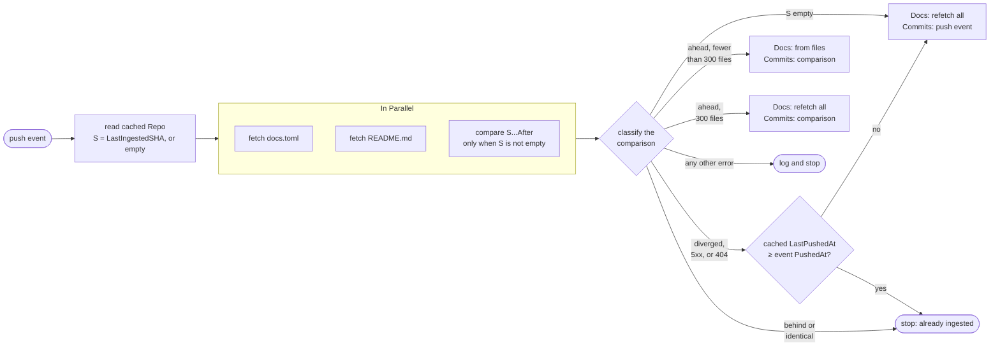

## Summary
[summary]: #summary

When a GitHub push event to the default branch arrives for an eligible repo, the server brings its Redis cache in line
with the repo's documentation at the pushed commit (the event's `after` SHA) and with its commit history.
Every file read for a push uses that same `after` SHA.
The work is split into an initial sequential step that validates the push, followed by two processes that run concurrently
and write independently once validation passes.

Pushes to other branches, and pushes to repos whose name is on the server's hard coded blacklist of names reserved for
site routes, are dropped by the webhook handler before any of this starts.

**Process zero: validation.** Make three GitHub API requests in parallel:

* Fetch `docs.toml` from the repo root at `after`.
* Fetch `README.md` from the repo root at `after`.
* Compare `Repo.LastIngestedSHA...after`, where `Repo.LastIngestedSHA` is the last commit whose docs were fully ingested.

The comparison's `status` decides what happens next: `ahead` continues; `behind` or `identical` means a newer or
identical push was already ingested, so the push stops without writing anything; `diverged` (a force push) triggers a
full reingest of every referenced path, as does an empty `Repo.LastIngestedSHA` (first ingest), a 5xx or 404 from the
comparison, or a truncated file list (300 files).
A `diverged`, 5xx, or 404 comparison cannot order the two commits, so in those cases the push stops as already ingested
when GitHub received the cached push no earlier than this one (`Repo.LastPushedAt`).
Comparing from what was actually ingested, rather than trusting the push's own commits, means a missed, failed, or
out of order push is picked up by the next one.

Once all three requests return, the push is validated before either process starts:

* `docs.toml` must parse;
* on the first ingest, `README.md` must exist.

`docs.toml` is the single source of truth for the repo's docs structure; it is parsed into `[]DocSection`,
a recursive type (`DocSection.SubSections []DocSection`) at most three levels deep (chapter, section, subsection).
Siblings keep the order in which their tables appear in `docs.toml`: chapters in `Repo.DocSections`, and the children
of each node in its `DocSection.SubSections`.
A repo is eligible only if `docs.toml` exists at the repo root (it may be empty) and `README.md` exists at its first ingest.
The project page is always rendered from `README.md` at the repo root; it is not configurable.
Every `path` in `docs.toml` is relative to the repo root, so doc files can live anywhere in the repo.

`README.md` is fetched alongside `docs.toml` on every push. Once the repo is cached, a missing `README.md` freezes the
project page like any other node: it keeps serving its cached HTML while the rest of the push is ingested normally.
If validation fails, the push logs a warning and stops: nothing is written and `Repo.LastIngestedSHA` is unchanged,
so the repo's cached docs and commits stay frozen until a later push fixes the problem and catches up.
The one exception is a `docs.toml` that existed at the last ingest and now returns 404 at a push the comparison does
not report as stale (`ahead`, `diverged`, or a 404 because the last ingested commit no longer exists): that triggers a deep clean,
which removes every trace of the repo from the cache, including its `repos` entry, its `{Repo.ID}:docs` hash,
and its members of `commits` (matched by `ConventionalCommit.RepoID`).
A repo whose `docs.toml` is later restored is ingested from scratch.

**Redis layout.**

* `repos`: a hash mapping each `Repo.ID` to its `Repo` JSON string, including `Repo.DocSections`.
  Keeping metadata in one hash makes fetching every repo for the landing page a single `HGETALL`.
* `{Repo.ID}:docs`: a hash mapping each ingested Markdown file's path, relative to the repo root
  (e.g. `README.md`, `docs/tutorials/database/connect.md`), to its rendered HTML string.
  One hash per repo gives each repo its own path namespace and makes removing a repo's docs a single `DEL`.
  Field keys match the file paths GitHub reports in comparisons, so no translation is needed.
* `commits`: a sorted set of `ConventionalCommit` JSON strings scored by commit timestamp, aggregated across all repos.

**Process one: docs.** Compare the cached `Repo.DocSections` with the freshly parsed one, together with the comparison's
file list, to classify every referenced Markdown path:

* **new**: referenced now but not before; fetch, parse to HTML, `HSET`.
* **outdated**: referenced before and now, and changed in the comparison; fetch, parse to HTML, `HSET`.
* **old**: referenced before but not by the docs as served now, where a frozen node keeps its cached path; `HDEL`.
  `README.md` is never **old**.
* **unchanged**: everything else; no work.

A chapter or section that becomes invalid, for example because its `path` points to a file that does not exist,
is frozen: the cached node, with its cached HTML, is kept exactly as it was at the last ingest until a later push makes
it valid again, while its children keep updating from `docs.toml`. At that point its own file is refetched, since edits
made during the freeze are not in the comparison.
An invalid node that was never ingested has nothing to freeze, so it is skipped together with its subtree.
Cached pages are removed only when their table is removed from `docs.toml`, which removes the table's descendants
recursively and puts their paths in **old**.
Existence is known without extra requests: **new** and **outdated** paths are fetched anyway, where a 404 marks them
invalid, and an **unchanged** path still exists unless the comparison lists it as removed.
A chapter's `path` is optional; a chapter without one is a non-clickable heading and contributes no path.
Fetches for **new** and **outdated** paths run concurrently.
All writes for the push, including the `Repo` JSON string with `Repo.LastIngestedSHA` set to `after`, are applied by a
single Redis transaction, and only if the stored `Repo.LastIngestedSHA` still equals the value read at the start.
The `Repo` JSON string is overwritten on every successful push, since one `HSET` is cheaper than diffing the metadata.
If the check fails, another push committed first. When GitHub received that push after this one
(`Repo.LastPushedAt`), this push is stale and stops. Otherwise it restarts from the new `Repo.LastIngestedSHA`
until it commits or the new comparison shows it is stale.
Any other failure writes nothing and leaves `Repo.LastIngestedSHA` unchanged, so the next push retries the work.

**Process two: commits.** Parse the comparison's commits into `ConventionalCommit` values, dropping any commit whose
message does not strictly follow the Conventional Commits specification, add them to `commits`,
then prune every member whose score is older than the current UTC time minus 90 days.
When there is no usable comparison (first ingest, `diverged`, or a 5xx or 404 from the comparison), the push event's
own commits are used instead.
Using the comparison means commits from pushes that were frozen or failed are logged once a later push succeeds;
commits that were already logged are added again harmlessly, since identical members are not duplicated.
Process two does not wait for process one's write: once validation passes, a failure in process one (a rate limit, a timeout,
or a lost SHA check) delays only the docs, which the next push catches up.

## Guide-level explanation
[guide-level-explanation]: #guide-level-explanation

Any repo can publish documentation to the site by adding a `docs.toml` file to the repo root.
Once that file exists, every push to the default branch keeps the site's copy of the docs up to date; there is no build step or deploy to run.

### Concepts

* **Project page**: the repo's landing page in the docs, rendered from `README.md` at the repo root.
  It is served at `/{repo name}`, where the repo name always matches the GitHub repo name and cannot be configured;
  `[project].title` only changes the displayed name.
* **Chapter**: a top level table in `docs.toml`, shown as a top level heading in the sidebar.
  A chapter may have its own page, without one it's a plain heading that only groups its sections.
* **Section**: a table nested under a chapter (or under another section), always backed by a Markdown file.
  Sections nest at most two levels below a chapter.
* **Segment**: the one piece of a page's URL path that a chapter or section contributes, defaulting to its table name.
  A table only names its own segment; its full path is its ancestors' segments stacked in front of it,
  so a child always lives under its parent's path.
* **Title**: the text shown in the sidebar, defaulting to the table name with dashes turned into spaces
  and the first character capitalized.

Every table name must be a slug, e.g. `getting-started`, and `[project]` is reserved for the project page.
The sidebar lists chapters, and the sections under each, in the order their tables appear in `docs.toml`.

### Example

```
my-lib/
├── README.md
├── docs.toml
└── docs/
    ├── getting-started.md
    ├── install/
    │   ├── linux.md
    │   └── macos.md
    └── guides/
        ├── database.md
        └── database-pooling.md
```

```toml
# docs.toml

[project]
title = "My Lib"

[getting-started]
path = "docs/getting-started.md"

[install]
title = "Installation"

[install.linux]
path = "docs/install/linux.md"

[install.macos]
path = "docs/install/macos.md"
title = "macOS"

[guides]

[guides.database]
path = "docs/guides/database.md"

[guides.database.pooling]
path = "docs/guides/database-pooling.md"
```

| Sidebar                         | URL                               | File                              |
| ------------------------------- | --------------------------------- | --------------------------------- |
| My Lib                          | `/my-lib`                         | `README.md`                       |
| Getting started                 | `/my-lib/getting-started`         | `docs/getting-started.md`         |
| Installation                    | (heading only)                    |                                   |
| &nbsp;&nbsp;Linux               | `/my-lib/install/linux`           | `docs/install/linux.md`           |
| &nbsp;&nbsp;macOS               | `/my-lib/install/macos`           | `docs/install/macos.md`           |
| Guides                          | (heading only)                    |                                   |
| &nbsp;&nbsp;Database            | `/my-lib/guides/database`         | `docs/guides/database.md`         |
| &nbsp;&nbsp;&nbsp;&nbsp;Pooling | `/my-lib/guides/database/pooling` | `docs/guides/database-pooling.md` |

Every page URL follows `/{repo name}/{chapter}/{section}/{sub section}`.
Each URL path is built by stacking segments: `pooling` sits under `database`, which sits under `guides`.
A heading-only chapter has no page of its own, but its segment still prefixes its children.
Setting `segment = "mac"` on `[install.macos]` would change only that page's URL to `/my-lib/install/mac`
setting `segment = "setup"` on `[install]` would move both children, to `/my-lib/setup/linux` and `/my-lib/setup/macos`.
URL paths and file paths are independent: renaming a segment moves a page's URL without touching its file.
When a page is requested, the server maps the repo name to its GitHub repo ID and the segments to the page's file path,
then serves the HTML cached for that file.

Every `path` in `docs.toml` is relative to the repo root, so it is exactly the path GitHub shows for the file.
Keeping doc files under `docs/` is a convention, not a requirement.

### What happens when you push

The site only does work for what a push actually changed. Continuing the example:

* You edit `docs/install/linux.md`. Only the Linux page is fetched and re-rendered; every other page is left alone.
* You change `title = "macOS"` to `title = "MacOS"`. The sidebar updates, but no Markdown is fetched,
  because no referenced file changed.
* You move the `[guides]` tables above `[install]`. The sidebar now lists Guides before Installation, and again
  no Markdown is fetched.
* You add `[guides.caching]` pointing to a new `docs/guides/caching.md`. That one file is fetched and rendered. 
* You delete the `[guides.database]` table. Both the Database and Pooling pages disappear,
  since removing a table removes everything nested under it. Removing a table is the only way to remove a page.
* You set `path = "docs/install/mac.md"` by mistake. That file does not exist, so the macOS entry is frozen:
  the site keeps serving the macOS page exactly as it was at the last successful push, while the rest of the docs,
  including anything nested under macOS, update normally. Once the path points to a real file again, the macOS entry
  catches up: its segment, title, and page all take effect. The same applies to a chapter: if `[install]` set a `path`
  that does not exist, the Installation heading would be frozen, while Linux and macOS keep updating.
* You add `[guides.caching]` but forget to commit `docs/guides/caching.md`. There is no earlier version to keep,
  so the entry is skipped until the file exists.
* You set `segment = "linux"` on `[install.macos]`. Two siblings now share a segment, so both are invalid:
  the Linux and macOS entries stay frozen at their last ingested versions until the collision is fixed,
  while anything nested under them keeps updating.
* You add `[guides.database.pooling.tuning]`. It is ignored, because it would be a fourth level of nesting.
* You delete `README.md`. The project page is frozen with a logged warning: the site keeps serving the last ingested
  project page, and the rest of the push is ingested normally. On a repo's first push, a missing `README.md` stops the
  push instead, since there is no project page to keep.
* You push a `docs.toml` with a syntax error. Same as above: the push fails early, the cached docs stay as they were,
  and the next push with a valid `docs.toml` picks up every change made in the meantime.
* You delete `docs.toml`. This is the only way to remove a repo's docs: a deep clean removes every trace of the repo
  from the site's cache, including its project page and its entries in the commit log.
* You add `docs.toml` back. The repo is ingested again from scratch, as if it were new.

Every push also adds its commits to the site wide commit log, which shows the last 90 days of activity across all repos.

### How to think about it

Treat `docs.toml` as the table of contents and the Markdown files as the pages.
The site mirrors whatever the table of contents on the default branch says, and re-renders a page only when
it is new to the table of contents or a commit touched its file.
A mistake in one entry freezes only that entry at its last good version, and never affects the rest of the docs;
only removing a table removes pages.

## Reference-level explanation
[reference-level-explanation]: #reference-level-explanation

This section follows a push from the webhook to Redis, then a page request from the browser back to Redis,
and ends by revisiting the Guide-level examples.

### `docs.toml` schema

`docs.toml` lives at the repo root.
It must exist for a repo to be eligible, but it may be empty, in which case every value takes its default
and the repo gets a project page and no chapters.

```toml
[project] # optional; reserved table name
title = "Name" # optional, defaults to the repo name with the first character capitalized
svg = '<svg></svg>' # optional

[project-chapter-beta] # optional; table name must be a slug
path = "x/y/z.md" # optional, relative to the repo root, must end with .md; without it the chapter is a heading only
segment = "a" # optional, must be a slug, defaults to the table name e.g. "project-chapter-beta"
title = "Project Chapter Beta" # optional, defaults to the table name with dashes turned into spaces and the first character capitalized e.g. "Project chapter beta"

[project-chapter-beta.section-a] # optional; table name must be a slug
path = "x/y/z.md" # required, relative to the repo root, must end with .md
segment = "b" # optional, must be a slug, defaults to the table name e.g. "section-a"
title = "Section A (updated)" # optional, defaults to the table name with dashes turned into spaces and the first character capitalized e.g. "Section a"

# nesting can only go up to a depth of 3; deeper tables are ignored
[project-chapter-beta.section-a.section-b] # optional; table name must be a slug
path = "x/y/z/w.md" # required, relative to the repo root, must end with .md
segment = "c" # optional, must be a slug, defaults to the table name e.g. "section-b"
title = "Section B" # optional, defaults to the table name with dashes turned into spaces and the first character capitalized e.g. "Section b"
```

A slug matches `^[a-z0-9]+(-[a-z0-9]+)*$`.
Depth is counted from the chapter: chapter is 1, section is 2, subsection is 3. 
Order is significant: chapters keep the order in which their tables appear in the file, and the children of every node keep the order 
in which their own tables appear. `[project]` is not a chapter and has no position.
Decoding into a Go map loses this order, so `reconcileDocsConfig` must read it from the document itself (the order reported by the TOML decoder's metadata).
Tables deeper than depth 3 are ignored with a warning.

Validation happens at two levels.
**File level** errors fail the whole push early (see [Validation](#validation)):

* `docs.toml` is not valid TOML.
* on the first ingest, `README.md` does not exist. After the first ingest, a missing `README.md` freezes the project
  page instead.

**Node level** errors make one chapter or section invalid. A warning is logged, the rest of the tree is ingested
normally, and the invalid node is [[0001-github-doc-parsing-and-caching#Node identity and frozen nodes|frozen]] if it was ingested before, or skipped if it
is new:

* The table name or `segment` is not a slug.
* A section has no `path`, or any `path` does not end in `.md`.
* The `path` points to a file that does not exist at `after`.
* Two siblings resolve to the same segment (both siblings are invalid).

### Node identity and frozen nodes

A node is identified by its table path, the chain of table names from its chapter down (e.g. `guides.database`),
independent of its `segment`, `title`, and `path`.
Renaming a table therefore removes one node and adds another.

* **Removed**: a cached node whose table path no longer appears in `docs.toml` is removed together with all of its
  descendants, and their paths fall into **old**. Moving a table under another parent, including one that would put it
  deeper than depth 3, changes its table path, so the cached node is removed and the moved table is a new node, or is
  ignored when it is too deep.
  This is the only way a cached page is removed.
* **Frozen**: an invalid node whose key path exists in the cached tree keeps its cached segment, title, and path,
  marked `Frozen`, and its path keeps its cached HTML. What `docs.toml` now says about the node itself is ignored
  while it stays frozen. Only the node is frozen: its children are still reconciled from `docs.toml` like any other
  node, and their URLs stack under the frozen node's cached segment. A frozen node is served like any other.
* **Skipped**: an invalid node with no cached counterpart has nothing to freeze, and its children have no segment to
  stack under, so the node and its entire subtree are left out.
* **Unfrozen**: a node that is valid now but was `Frozen` at the last ingest takes its segment, title, and path from
  `docs.toml` again, and its own path is treated as **outdated**. Other pushes kept succeeding while it was frozen,
  so `Repo.LastIngestedSHA` has moved past any edits made to its file, and the comparison alone would miss them.
  Its children need nothing extra, since they were reconciled on every push while it was frozen.

Position is never frozen: a frozen node stays where its table now appears among its siblings, and its children keep
the order of their own tables. A skipped node leaves no gap.
Reordering a node among its siblings keeps its table path and touches no file path, so it is not **Removed** and only
the `Repo` JSON is rewritten.

### Data model

`Repo` gains the fields that describe the docs, plus `DocRoutes`, derived from them when a repo is loaded into the
local cache and never stored, and `Repos` gains a name to ID map; `ConventionalCommit` gains `RepoID` and drops
`RepoName`, so a deep clean can find a repo's commits and the commit log can show its current name even after the
repo is renamed.
```go
// The local cache of every repo and the commit log, synced with Redis by syncLocalCache.
type Repos struct {
	client      Client               // Redis
	github      Github               // new: GitHub REST API calls used by ingestion
	repoCache   map[int64]*Repo      // Repo.ID -> repo
	names       map[string]int64     // new: Repo.Name -> Repo.ID, used only to resolve the first URL segment
	commitCache []ConventionalCommit // newest to oldest
	mu          sync.RWMutex         // guards repoCache, names, and commitCache, which are updated together
}

// A Git repo displayed as a project, stored as a JSON string in the `repos` hash.
type Repo struct {
	ID              int64        `json:"id"`                // immutable GitHub repo ID
	Name            string       `json:"name"`              // GitHub repo name, the first URL segment
	FullName        string       `json:"full_name"`         // owner/name, used for GitHub API requests
	Title           string       `json:"title"`             // [project].title, or Name with the first character capitalized
	Description     string       `json:"description"`       // GitHub repo description
	SVG             string       `json:"svg"`               // [project].svg
	DocSections     []DocSection `json:"doc_sections"`      // chapters as served, in docs.toml order: invalid nodes frozen or skipped
	LastCommit      time.Time    `json:"last_commit"`       // timestamp of the push's head commit
	LastIngestedSHA string       `json:"last_ingested_sha"` // last commit whose docs were fully ingested
	LastPushedAt    time.Time    `json:"last_pushed_at"`    // when GitHub received the push at LastIngestedSHA; orders pushes the comparison cannot

	// Derived by the local cache on load, never written to Redis.
	DocRoutes map[string]string `json:"-"` // stacked segments to file path, e.g. "install/linux" -> "docs/install/linux.md"; "" -> README.md
}

// A chapter, section, or subsection parsed from docs.toml.
type DocSection struct {
	Frozen      bool         `json:"frozen,omitempty"` // kept from the last ingest because the node is currently invalid
	Segment     string       `json:"segment"`          // this node's URL segment, without its ancestors
	Title       string       `json:"title"`            // sidebar text
	Path        string       `json:"path"`             // repo root relative file path; empty for a heading only chapter
	SubSections []DocSection `json:"sub_sections"`     // children in docs.toml order, at most depth 3 in total
}

// A Git commit that conforms to the Conventional Commits standard.
type ConventionalCommit struct {
	ID        string    `json:"id"`
	RepoID    int64     `json:"repo_id"` // new: matches Repo.ID, used by the deep clean and to look up the repo's current name
	Timestamp time.Time `json:"timestamp"`

	Type        string `json:"type"`
	Scope       string `json:"scope"`
	Description string `json:"description"`
	Body        string `json:"body"`
}
```

GitHub's own types come from `github.com/google/go-github/v91/github`, so the server defines none of its own:

| Fields                                                                        | Source go-github type         |
| ----------------------------------------------------------------------------- | ----------------------------- |
| the push webhook payload (`Ref`, `After`, `Repo`, `HeadCommit`, `Commits`)    | `*github.PushEvent`           |
| the pushed repo (`ID`, `Name`, `FullName`, `Description`, `DefaultBranch`)    | `*github.PushEventRepository` |
| a commit in the push payload (`ID`, `Message`, `Timestamp`)                   | `*github.HeadCommit`          |
| the compare API response (`Status`, `Commits`, `Files`)                       | `*github.CommitsComparison`   |
| a commit in the comparison (`SHA`, `Commit.Message`, `Commit.Committer.Date`) | `*github.RepositoryCommit`    |
| a file in the comparison (`Filename`, `Status`, `PreviousFilename`)           | `*github.CommitFile`          |
| a failed request, carrying the HTTP status                                    | `*github.ErrorResponse`       |

Every go-github field is a pointer and is read through its nil safe accessor (e.g. `event.GetAfter()`,
`event.GetRepo().GetDefaultBranch()`); the rest of this RFC uses field names for brevity.
Timestamps are `github.Timestamp`, which wraps `time.Time`.
The two API calls ingestion makes sit behind a small interface, satisfied by a thin wrapper over `*github.Client`,
so ingestion can be tested with a mock just as `Client` mocks Redis:

```go
// The GitHub REST API calls ingestion needs.
type Github interface {
	// Fetches a file's contents at a commit through Repositories.GetContents; ok is false when it returns 404.
	FetchFile(ctx context.Context, fullName, path, sha string) (data []byte, ok bool, err error)

	// Compares two commits through Repositories.CompareCommits.
	Compare(ctx context.Context, fullName, base, head string) (*github.CommitsComparison, error)
}
```

The wrapper splits `FullName` into the owner and repo arguments go-github expects.

Intermediate values passed between steps:

```go
// The project settings and node tree read from docs.toml, resolved against the cached repo and the comparison.
type DocsConfig struct {
	FullName    string    // owner/name of the pushed repo, used for GitHub API requests
	SHA         string    // the commit docs.toml was read at, event.After
	Title       string
	SVG         string
	ReadMe      []byte    // contents of README.md at SHA, fetched alongside docs.toml; nil when it returned 404
	Sections    []DocNode // every table up to depth 3, in docs.toml order

	// The new, outdated, and unfrozen paths to fetch at SHA (every referenced path when the comparison cannot be trusted),
	// leaving out Skipped subtrees.
	UpdatePaths []string
}

// A node of the docs.toml tree as ingestion sees it; buildRepo turns the kept ones into DocSections.
type DocNode struct {
	Key        string    // table key path, e.g. "install.macos"; the node's identity across pushes
	Segment    string    // from docs.toml, or the cached segment while Frozen
	Title      string    // from docs.toml, or the cached title while Frozen
	Path       string    // from docs.toml, as written
	CachedPath string    // the cached counterpart's path, empty when never ingested
	Frozen     bool      // invalid with a cached counterpart: keeps its cached fields, its children are reconciled normally
	Skipped    bool      // invalid with no cached counterpart: left out with its whole subtree
	Missing    bool      // Path is known not to exist: removed in the comparison or 404 on fetch
	Children   []DocNode // in docs.toml order
}
```

### Redis layout

| Key | Type | Contents |
|---|---|---|
| `repos` | hash | `Repo.ID` to `Repo` JSON string |
| `{Repo.ID}:docs` | hash | repo root relative file path to rendered HTML string |
| `commits` | sorted set | `ConventionalCommit` JSON strings scored by `Timestamp` as Unix seconds |
| `repos:updates` | pub/sub channel | `repos:{Repo.ID}` after a docs write or deep clean, `commits` after a commit log write |

A commit is logged at most once because the same commit always serializes to the same JSON string:
every `ConventionalCommit` field is derived from the commit itself or from the immutable `Repo.ID`, and `Timestamp` is
always the committer date, whether it comes from the comparison or from the push event.
No field may ever be derived from the push (such as the time it was received), or the same commit would become two members.
The repo name is not stored for the same reason, since a rename would change it; the commit log resolves it from
`RepoID` through the local cache when it renders.

### Webhook

```go
// Responds 202 to a GitHub push webhook and starts ingestion in the background for pushes that apply.
func (a *App) githubPushEvent(w http.ResponseWriter, r *http.Request)
```

1. Decode the body into a `github.PushEvent`; respond 400 if it does not decode.
2. Respond 202 immediately.
3. If `Ref` is not `refs/heads/{event.Repo.DefaultBranch}`, stop.
4. If `event.Repo.Name` is on the hard coded blacklist, log and stop.
5. Run `Repos.Set` in a goroutine with its own context and a 60 second timeout, independent of the request.

Filtering here means `Set` can assume every event it receives is a default branch push to a repo that may be ingested.

If an instance shuts down mid ingestion the work is lost, but `Repo.LastIngestedSHA` has not moved, so the next push
redoes it.

### Ingestion

```go
// Brings the cache in line with the repo at event.After, retrying when another push commits first.
func (r *Repos) Set(ctx context.Context, event *github.PushEvent) error
```

#### Process zero

1. Read the cached `Repo` for `event.Repo.ID` from the in memory cache; `S` is its `LastIngestedSHA`, or empty if the
   repo is not cached. On a restart, read it from Redis (`HGET repos {Repo.ID}`) instead, since the local cache may not
   have caught up with the push that committed first; a missing entry on a restart means a deep clean committed first,
   so stop.
2. In parallel fetch `docs.toml` and `README.md` at `event.After`, and, if `S` is not empty, compare `S...event.After`.
   A restart reuses the files already fetched, since `event.After` has not changed, and only compares again.
3. Classify the comparison. **Docs** decides which paths `reconcileDocsConfig` puts in `UpdatePaths` and which nodes
   it marks `Missing`; **Commits** decides where process two reads commits from.



| Condition                                                                                                                                   | Docs                                                 | Commits    |
| ------------------------------------------------------------------------------------------------------------------------------------------- | ---------------------------------------------------- | ---------- |
| `S` empty (first ingest, or after a deep clean)                                                                                             | refetch all                                          | push event |
| `status` is `ahead` and `files` has fewer than 300 entries                                                                                  | from `files`                                         | comparison |
| `status` is `ahead` and `files` has 300 entries (may be truncated)                                                                          | refetch all                                          | comparison |
| `status` is `behind` or `identical`                                                                                                         | stop: a push at or past `after` was already ingested | stop       |
| `status` is `diverged` (force push)                                                                                                         | refetch all                                          | push event |
| the request returns 5xx (diff too large), i.e. a `*github.ErrorResponse` with a 5xx status                                                  | refetch all                                          | push event |
| the request returns 404 (`S` no longer exists, e.g. garbage collected after a force push), i.e. a `*github.ErrorResponse` with a 404 status | refetch all                                          | push event |
| any other error                                                                                                                             | log and stop                                         | fail       |

* **from `files`**: a referenced path listed as `added`, `modified`, or `renamed` (its `Filename`) is **outdated**,
  and an unchanged path listed as `removed`, or as the `PreviousFilename` of a rename, marks its node `Missing`.
* **refetch all**: every referenced path goes in `UpdatePaths`, and no node is marked `Missing` from the comparison;
  a file that no longer exists is found by its fetch returning 404.

A `diverged`, 5xx, or 404 comparison says nothing about which of `S` and `after` is newer, and a full reingest settles
the content but not the order: a stale push would faithfully ingest an outdated `after`. In those cases, if the cached
`Repo.LastPushedAt` is at or after `event.Repo.PushedAt`, stop as already ingested. A tie stops, keeping what is cached,
since `PushedAt` has one second resolution. A repo cached before `LastPushedAt` existed has a zero value, which never stops.

#### Validation

1. If `docs.toml` returned 404:
	- If `S` is not empty and the comparison reported `ahead` or `diverged`, or returned 404, the file existed at the
	  last ingest, so run the [[0001-github-doc-parsing-and-caching#Deep clean|deep clean]] and stop.
	  A 404 means `S` no longer exists, so no later comparison could ever confirm the deletion; a stale push wiping a
	  newer ingest would need both a lost `S` and an out of order delivery, which is accepted over keeping the repo cached forever.
	- If `S` is not empty and the comparison failed with any other error (a 5xx, a timeout, a rate limit), the order of
	  `after` and `S` is unknown, and a stale push must not wipe a newer ingest: log a warning and fail without writing;
	  the next push retries.
	- Otherwise the repo was never eligible, stop.

2. Parse `docs.toml` into `DocsConfig`. A TOML syntax error logs a warning and stops.
   Node level errors mark the node invalid with a warning; process one decides whether it is frozen or skipped.
3. Check the `README.md` fetch:
	- 404 and the repo is not cached: log a warning and stop, since there is no project page to keep.
	- 404 and the repo is cached: log a warning and leave `DocsConfig.ReadMe` nil, so the project page keeps its cached HTML.
	- Found: keep the contents in `DocsConfig.ReadMe` so process one renders them without a second request.

Stopping at any point in this step writes nothing and leaves `Repo.LastIngestedSHA` unchanged, which freezes the repo's
cached docs and commits until a later push passes validation and catches up from `S`.
Once validation passes, process one and process two start concurrently.

```go
var (
	ErrDocsSyntax = errors.New("docs.toml syntax error") // log a warning and stop: the repo stays frozen
	ErrCompare    = errors.New("compare failed")         // a failure: nothing is written
)

// Parses docs.toml in table order, resolves it against cached, and marks it from the comparison: nodes with a parse time
// error are Frozen when cached and Skipped with their subtree when not, unchanged paths the comparison reports removed
// are Missing, and UpdatePaths lists the paths to fetch.
func reconcileDocsConfig(data []byte, event *github.PushEvent, cached *Repo, comp *github.CommitsComparison, compErr error) (*DocsConfig, error)
```
 
#### Process one

1. Collect the referenced paths of the cached tree `before` and of the parsed tree's nodes without a parse time error `now`, every non empty `DocSection.Path` plus `README.md`.
2. Classify:
	- **new**: in `now`, not in `before`.
	- **outdated**: in both, and changed according to the comparison's **Docs** result (every path in both when it is
	  **refetch all**), plus the path of every node that was `Frozen` at the last ingest and has no parse time error now.
	
	`reconcileDocsConfig` lists every **new** and **outdated** path, outside Skipped subtrees, in `DocsConfig.UpdatePaths`.

3. Fetch and render every **new** and **outdated** path concurrently at `event.After`.
   Children are fetched alongside their parents rather than after them; fetching a child of a node that turns out to be
   skipped wastes a request but keeps the fetch to one round trip.
4. A node is `Missing` if its path's fetch returned 404 (marked by `fetchDocs`), or if its path is **unchanged** and
   the comparison's **Docs** result is **from `files`** and lists it as removed (marked by `reconcileDocsConfig`).
   A node is invalid if it has a parse time error or a missing path.
5. Build the effective tree from the parsed tree, keeping its order. An invalid node with a cached counterpart keeps
   its cached segment, title, and path, marked `Frozen`, while its children stay as parsed; one without a cached
   counterpart is skipped together with its subtree. Discard any HTML fetched for a frozen node's path or for paths
   inside skipped subtrees.
6. **old** is every path in the stored tree at `S` other than `README.md` that is not in the effective tree, which
   covers removed tables and their descendants as well as files a node no longer points to. `README.md` is never
   **old**: only a deep clean removes the project page. It is computed inside the commit, from the `Repo` read under
   `WATCH`, which is the same tree as `before` whenever the SHA check passes, so it always matches what Redis holds.
7. Build the new `Repo`: GitHub metadata from the event, settings from `DocsConfig`, the effective `DocSections`,
   `LastCommit` from `HeadCommit`, `LastIngestedSHA` set to `event.After`, and `LastPushedAt` set to
   `event.Repo.PushedAt`.
8. Run the [[0001-github-doc-parsing-and-caching#Commit|commit]] with expected SHA `S`.
	* `Committed`: done.
	* `Superseded`: a push GitHub received after this one committed first, so this push is stale. Stop without writing.
	* `Overtaken`: a push GitHub received no later than this one committed first. This push is still the newer one, but
	  its work was built on `S`: the comparison misses any file changed between `S` and the new SHA (a file changed and
	  then changed back looks unchanged in `S...after`).
	  Restart at Process zero step 1 with the new `S`. The restarted comparison either stops the push or covers only the
	  remaining gap.
	
	Only a push received no later than this one can cause a restart, and once this push commits, every such push still
	running stops, so the loop ends on its own. The cap of 3 restarts is a safety net; exhausting it is a failure.

9. Any error (a non 404 fetch failure, a rendering error, a Redis error, a timeout) is a failure: nothing is written and
   the next push retries the work from `S`.

```mermaid
flowchart LR
	collect["collect paths<br/>before: cached tree<br/>now: parsed tree + README.md"] --> classify{classify<br/>each path}

	classify -->|"path is in now,<br/>and not in before"| pathNew[new]
	classify -->|"path is in both and changed per Docs,<br/>or is the path of a node that became unfrozen"| pathOutdated[outdated]
	classify -->|otherwise| pathUnchanged[unchanged]

	pathNew & pathOutdated --> fetch["fetch and render UpdatePaths<br/>concurrently at After"]
	fetch --> missing["mark Missing<br/>fetch 404, or unchanged<br/>and removed in files"]
	pathUnchanged --> missing

	missing --> invalid{"node invalid?<br/>parse error or Missing"}
	invalid -->|no| keep[keep node]
	invalid -->|"yes, cached"| freeze["freeze: keep cached node,<br/>children stay as parsed"]
	invalid -->|"yes, never cached"| skip["skip with its subtree,<br/>discard fetched HTML"]

	keep & freeze & skip --> effective["effective tree<br/>in docs.toml order"]
	effective --> build["build Repo<br/>LastIngestedSHA = After"]
	build --> commit{"commit with expected S<br/>old: paths in stored tree<br/>not in effective tree,<br/>except README.md"}

	commit -->|Committed| done([done])
	commit -->|Superseded| stopSuperseded([stop: a later push already committed])
	commit -->|"Overtaken, restarts left"| restart[["restart at Process zero step 1<br/>with the new S, read from Redis"]]
	fetch & commit -.->|"3 restarts used, non 404 fetch, render,<br/>Redis error, or timeout"| failError(["log and stop: nothing is written,<br/>next push retries from S"])
```



```go
// Decodes, filters, and hands off; it knows nothing about eligibility or ingestion.
// Inline: decode the body into a github.PushEvent (400 if it does not decode), respond 202, stop unless Ref is
// refs/heads/{Repo.DefaultBranch}, log and stop if Repo.Name is blacklisted, then run Repos.Set in a goroutine with
// context.WithoutCancel and a 60 second timeout, logging its error.
func (a *App) githubPushEvent(w http.ResponseWriter, r *http.Request)

// Owns the whole ingestion of one push the handler accepted, from reading the cache to committing the result.
// Inline, in order:
//   1. read cached and S (its LastIngestedSHA, empty when not cached) under mu.RLock, or from Redis on a restart,
//      stopping if the repo is gone; restarts begin here
//   2. in parallel FetchFile docs.toml and README.md and, when S is not empty, Compare S...After; a restart reuses
//      the fetched files and only compares
//   3. stop if the comparison is behind or identical, or if it is diverged or failed with a 5xx or 404 and
//      cached.LastPushedAt is not before event.Repo.PushedAt, before anything can act on a stale After
//   4. docs.toml 404: when S is not empty, dropFromCache if the comparison is ahead or diverged or returned 404,
//      otherwise fail (a failed comparison cannot rule out a stale After); when S is empty, stop
//   5. reconcileDocsConfig; ErrDocsSyntax logs a warning and stops, ErrCompare fails
//   6. README.md 404: stop when cached is nil, otherwise leave cfg.ReadMe nil; when found, store the bytes in
//      cfg.ReadMe
//   7. run process one and process two concurrently, waiting for both even when one fails and returning their errors joined
//      process one: fetchDocs, buildRepo, commitDocs; Superseded stops, Overtaken restarts at 1, up to 3 times
//      process two: pick comp.Commits, or event.Commits when S is empty, the comparison diverged, or it failed with a 5xx
//      or 404, convert with fromComparisonCommit or fromPushCommit, then setCommits
func (r *Repos) Set(ctx context.Context, event *github.PushEvent) error

// Fetches and renders every path in cfg.UpdatePaths at cfg.SHA concurrently, using cfg.ReadMe for README.md
// instead of a request (skipping it when nil, so it keeps its cached HTML), and marks the nodes of every path that
// returned 404 Missing once all fetches finish.
func (r *Repos) fetchDocs(ctx context.Context, cfg *DocsConfig) (html map[string]string, err error)

// Builds the repo to store at event.After from cfg in docs.toml order: a Missing node with a cached counterpart is frozen
// with its cached segment, title, and path, a Missing node without one is skipped with its whole subtree, and skipped
// subtrees are left out.
func buildRepo(event *github.PushEvent, cfg *DocsConfig) Repo

// Lists every DocSections path referenced by before that after no longer references; README.md is never old.
// Called by commitDocs with the repo read under WATCH; a nil before (first ingest) has no old paths.
func pruneRepo(before, after *Repo) (old []string)
```

#### Process two

1. Take commits from the source in the comparison's **Commits** result: the comparison's `commits`, or the push
   event's `Commits` when there is no usable comparison (an empty `S`, `diverged`, or a 5xx or 404).
   A truncated file list does not affect this, so a 300 file comparison still supplies the commits.
2. Parse each into a `ConventionalCommit`; drop any commit whose message does not strictly follow the Conventional
   Commits specification. `distinct` is ignored: every commit in range is considered.
3. `ZADD commits` every parsed commit, then `ZREMRANGEBYSCORE commits -inf {now - 90 days}`, then
   `PUBLISH repos:updates commits`.

Process two does not wait for process one. If process one later fails, `S` has not moved, so the next push compares from `S`
again and re-adds the same commits, which leaves the sorted set unchanged.
A restart reruns both processes. Process two re-adds commits it may already have logged, which leaves the sorted set
unchanged, and picks up any commits the first run missed because it read them from the push event rather than a
comparison.

```go
// Parses a comparison commit, timestamped by its committer date.
func fromComparisonCommit(repo *github.PushEventRepository, c *github.RepositoryCommit) (ConventionalCommit, bool)

// Adds commits to the commit log and prunes entries older than 90 days.
func (r *Repos) setCommits(ctx context.Context, commits []ConventionalCommit) error
```

### Transactions

Both writes are optimistic transactions (`WATCH`, `MULTI`, `EXEC`, through go-redis's `Watch`).
Each one watches `repos`, reads `HGET repos {Repo.ID}`, and compares the stored `LastIngestedSHA` against the expected
SHA, treating a missing field as an empty SHA. The writes are queued in `MULTI` and applied by `EXEC` all together or
not at all, and `EXEC` applies nothing if `repos` changed after the `WATCH`, so the check and the writes are atomic
across instances.

`WATCH` covers the whole `repos` hash, not one field, so an update to any repo aborts the transaction. That abort is
retried inside the function, up to 3 times, since it does not mean this repo changed: only a SHA mismatch ends the
commit without writing.
Pushes to different repos rarely overlap, so the extra retries are rare. If they ever matter, each repo's SHA can move to
its own key to watch instead.

#### Commit

* `WATCH repos`, then check the SHA. If it differs from the expected SHA, return without writing: `Superseded` when the
  stored `LastPushedAt` is after the new `Repo`'s, otherwise `Overtaken`. A tie is `Overtaken`, so the restarted
  comparison, which orders commits exactly, decides instead of the one second clock.
* Otherwise compute the **old** paths with `pruneRepo` from the stored `Repo` (nil when missing) to the new one, then
  queue `HDEL {Repo.ID}:docs` the **old** paths, `HSET {Repo.ID}:docs` the path and HTML pairs for **new**
  and **outdated**, `HSET repos {Repo.ID}` the new JSON, and `PUBLISH repos:updates repos:{Repo.ID}`, then `EXEC`.

#### Deep clean

* `WATCH repos`, then check the SHA. If it differs from the expected SHA, return false without writing, so a stale push
  cannot wipe out a newer ingest.
* Otherwise `ZRANGE commits 0 -1` and keep the members whose `repo_id` matches, then queue `DEL {Repo.ID}:docs`,
  `HDEL repos {Repo.ID}`, `ZREM commits` those members, `PUBLISH repos:updates repos:{Repo.ID}`, and
  `PUBLISH repos:updates commits`, then `EXEC`.

Scanning `commits` is linear in its size, which the 90 day prune keeps small.

```go
// How a commit transaction ended.
type CommitResult int

const (
	Committed  CommitResult = iota // the SHA matched and every write was applied
	Superseded                     // a push GitHub received later committed first: stop, this push is stale
	Overtaken                      // a push GitHub received no later committed first: restart from its SHA
)

// Runs the commit transaction; when Repo.LastIngestedSHA no longer equals expected, writes nothing and orders the two
// pushes by LastPushedAt. The old paths are pruned from the stored repo read under WATCH.
func (r *Repos) commitDocs(ctx context.Context, repo Repo, expected string, html map[string]string) (CommitResult, error)

// Runs the deep clean transaction; ok is false when Repo.LastIngestedSHA no longer equals expectedSHA.
func (r *Repos) dropFromCache(ctx context.Context, repoID int64, expectedSHA string) (bool, error)
```

`Client` grows to cover `Watch`, `ZRange`, `ZAdd`, `ZRemRangeByScore`, and `Publish`.

### Local cache and serving pages

`syncLocalCache` already reloads a repo on `repos:{Repo.ID}`.
The local cache keeps two maps, updated together under the same lock: `map[int64]*Repo` from `Repo.ID` to the repo,
matching how Redis keys, pub/sub messages, and commits identify a repo, and `map[string]int64` from `Repo.Name` to
`Repo.ID`, used only to resolve the first URL segment. `syncLocalCache` changes in three ways:

* when `HGET repos {Repo.ID}` finds nothing (a deep clean), the repo and its name are removed from the cache instead of
  logging a warning;
* every reloaded repo gets its `DocRoutes` derived before it is stored, under the same lock, so a request never sees a
  tree and doc routes from different pushes;
* a reloaded repo replaces the entry with the same `Repo.ID`; if its name changed, the old name is read from the
  replaced entry and removed from the name map, so a rename takes effect as soon as the next successful push rewrites
  the `Repo` JSON. Old names stop resolving; cached HTML is untouched because it is keyed by ID.

`DocRoutes` is derived per instance rather than stored, because it costs microseconds to compute from `DocSections`,
while storing it would duplicate the tree in Redis. Redis holds only what is expensive to get: the rendered Markdown,
which costs GitHub requests.

The sidebar is a shell that stays on the page while the doc beside it changes, using htmx:

* A **full page load** (the first visit, a deep link, or a refresh) renders the sidebar from `Repo.DocSections` with an
  `html/template`, which escapes titles from `docs.toml`, around the doc's HTML.
* Each sidebar link carries `hx-get`, `hx-target="#doc"`, and `hx-push-url="true"`, so following it requests only the
  doc and keeps the URL shareable. The server answers a request with an `HX-Request` header with the doc's HTML alone.
* Each link also carries its route (e.g. `data-route="install/linux"`), which an `htmx:afterSwap` handler uses to mark
  the current entry.
* Partial and full responses share a URL, so every docs response sends `Vary: HX-Request` to keep a cache from serving
  a fragment as a full page.

A sidebar rendered before a push stays on the page after it. A link whose page was since removed misses `DocRoutes`
and redirects to `/{repo name}`, which htmx follows as a full page load with a fresh sidebar.

Pages are served at `/{repo name}/{table.segment}/{table.table.segment}/{table.table.table.segment}`:

1. Look up the first segment in the name map, then the `Repo` by ID. An unknown name is a 404.
2. Look up the remaining segments, joined with `/`, in `Repo.DocRoutes`; no segments is `""`, the project page.
   A miss (no such segment, a heading only chapter, or too many segments) redirects to `/{repo name}`.
3. `HGET {Repo.ID}:docs {path}` and serve the HTML; a full page load also renders the sidebar from the repo resolved
   in step 1.

```go
var (
	ErrUnknownRepo = errors.New("unknown repo") // respond 404
	ErrUnknownPath = errors.New("unknown path") // redirect to /{repo name}
)

// Builds a cache ready repo from its stored JSON: decodes it and maps every node with a non empty Path (plus the project
// page under "") to its file path keyed by stacked segments in DocRoutes.
func NewRepo(data []byte) (*Repo, error)

// Stores a derived repo in the local cache by ID and maps its name to that ID, removing its old name if it was renamed.
func (r *Repos) replace(repo *Repo)

// Removes the repo with the given ID, and its name, from the local cache.
func (r *Repos) dropFromLocal(repoID int64)

// Resolves a page URL to its repo and file path; ErrUnknownRepo for an unknown name, ErrUnknownPath for an unknown route.
// Fetches the cached HTML for a repo's doc file from {repoID}:docs.
func (r *Repos) Doc(ctx context.Context, URL string) (string, error)

// Returns the cached repo with the given name, whose DocSections render the sidebar on a full page load; ErrUnknownRepo
// when no repo has that name.
func (r *Repos) Repo(name string) (*Repo, error)
```

Repo renames arrive as a separate `repository` webhook event, which this RFC does not handle, so until the next push the
old name keeps working and the new one is a 404.

### The Guide-level examples, revisited

| Example | What happens |
|---|---|
| Edit `docs/install/linux.md` | The comparison touches it, so it is **outdated**; only it is fetched |
| Change a `title` | No referenced path is new, old, or touched; only the `Repo` JSON is rewritten |
| Move `[guides]` above `[install]` | Siblings are reordered; no path changes, so only the `Repo` JSON is rewritten |
| Add `[guides.caching]` | `docs/guides/caching.md` is **new** and is fetched |
| Delete `[guides.database]` | Its key path is gone, so it and its child are removed; both paths are **old** and deleted |
| `path = "docs/install/mac.md"` | The **new** path returns 404; `install.macos` is cached, so it is frozen and `docs/install/macos.md` keeps its HTML |
| Fix the path back to `macos.md` | `install.macos` was `Frozen`, so its path is **outdated** and refetched |
| Add `[guides.caching]` without its file | The **new** path returns 404 and `guides.caching` was never cached, so it is skipped |
| `segment = "linux"` on `[install.macos]` | Sibling collision at parse time; both nodes are cached, so both are frozen |
| `[guides.database.pooling.tuning]` | Depth 4, ignored at parse time |
| Delete `README.md` | Its fetch alongside `docs.toml` returns 404; the repo is cached, so `ReadMe` is nil and `README.md` keeps its cached HTML |
| `docs.toml` syntax error | Validation stops the push; `S` does not move, so the fixing push compares from `S` and catches up |
| Delete `docs.toml` | 404 with a non empty `S` and an `ahead`, `diverged`, or 404 comparison: deep clean |
| Restore `docs.toml` | The repo is no longer cached, so `S` is empty and the push is a full ingest |

## Prior art
[prior-art]: #prior-art

The direct predecessor is this site's own first attempt, written in Rust (Leptos, axum, comrak) and removed in the
Go rewrite; it can be read at commit `ef118d9`, mainly `src/api/repo_cache.rs`, `src/api/webhooks.rs`,
and `docs/specs/003-dyndocs/design.md`.
It solved the same problem with a different set of trade offs, and most of this RFC is a response to what it got wrong.

### How the legacy system worked

* **Config**: each repo needed `docs/overview.md`, whose JSON front matter registered the sections and whose Markdown
  body became the project home page.
* **Structure**: a section was a directory directly under `docs/` and its pages were the `.md` files inside it,
  so the tree was fixed at two levels and file paths were derived from directory and file names.
* **URLs**: `/docs/{repo name}/{section}/{file}`, slugified from the directory and file names.
* **Redis**: one global `repos:docs` hash keyed by `{id}:docs:{section}:{file}.md`, holding JSON with the HTML and
  extracted h1 and h2 headings; `repos:states` for metadata; a per repo `{id}:commits` sorted set plus a global
  `commits` sorted set, each capped at 50 entries by rank.
* **Change detection**: the push payload's commits, replayed newest to oldest so that a later `removed` shadows an
  earlier `modified`, plus the set difference between the registered paths in the new and cached front matter.
  A cold cache ingested every registered path.
* **Writes**: the new front matter was written and published first, then every changed file was fetched from
  `raw.githubusercontent.com`, rendered, and written with its own `HSET`.
* **Webhook**: verified `X-Hub-Signature-256` with HMAC, ignored non default branch pushes, and ran doc reconciliation
  in a background task.

### What carries over

* The default branch filter, background processing, and reading every file at a single commit.
* Rendered HTML cached in Redis keyed by repo ID, with pub/sub to keep every instance's in memory cache fresh.
  The legacy design doc's sizing still holds: a 250 line Markdown file renders to roughly 30KB of HTML, so even
  5 projects with 100 pages each is about 15MB.
* Diffing the cached tree against the new one, so a config change alone triggers no Markdown fetches.

### What changes, and why

| Legacy behavior                                              | Problem                                                                                                               | This RFC                                                                                |
| ------------------------------------------------------------ | --------------------------------------------------------------------------------------------------------------------- | --------------------------------------------------------------------------------------- |
| Config in front matter of a Markdown file                    | Config and content mixed in one file; JSON front matter was awkward enough that switching to YAML was already planned | A dedicated `docs.toml` at the repo root; the project page is an ordinary Markdown file |
| Fixed `docs/{section}/{file}.md` layout                      | Two levels only; URLs tied to file names, so renaming a page meant moving a file                                      | Explicit `path` per node, three levels, and `segment` decoupled from the file           |
| Change detection from the payload's commits                  | A missed delivery, a failed fetch, or a push over 20 commits left pages stale with no recovery                        | Compare `Repo.LastIngestedSHA...after`, so the next push catches up                     |
| Front matter written and published before pages were fetched | Routes could point at HTML that was never cached when a fetch failed                                                  | Nothing is written until every fetch succeeds                                           |
| Each page written with its own `HSET`, failures only logged  | A partial failure left a mix of old and new pages                                                                     | One transaction writes everything or nothing                                            |
| No coordination between pushes or instances                  | Overlapping pushes could overwrite newer pages with older ones                                                        | The commit only writes if `Repo.LastIngestedSHA` is unchanged                           |
| Deleted pages never removed (marked "PLANNED" in the code)   | Stale HTML accumulated in Redis                                                                                       | **old** paths are deleted, and removing `docs.toml` deep cleans the repo                |
| One global docs hash                                         | Removing a repo meant scanning keys                                                                                   | One `{Repo.ID}:docs` hash per repo, removed with a single `DEL`                         |
| Commit log capped at 50 entries by rank                      | The log's time span depended on how busy the repos were                                                               | A 90 day window pruned by score                                                         |
| Repo resolved by name with a linear scan                     | Fine at a handful of repos                                                                                            | A name to ID map maintained by the local cache                                          |

### What this RFC drops

* **Heading extraction**: the legacy renderer extracted each page's h1 and h2 headings into a nav tree and cached
  them alongside the HTML. This RFC caches only the HTML string.
* **Per repo commit logs**: only the global `commits` sorted set remains.

## Unresolved questions
[unresolved-questions]: #unresolved-questions

To resolve before implementation:

* **Webhook signature verification**: the legacy system verified `X-Hub-Signature-256` with HMAC SHA256 and a
  `WEBHOOK_SECRET`; go-github's `github.ValidatePayload(r, secret)` performs the same check and returns the body,
  so what remains is deciding whether to require it and confirming it runs before the 202.
* **GitHub API authentication and rate limits**: which token the server uses (a personal access token or a GitHub App),
  how it is configured, and what happens when the authenticated limit of 5,000 requests an hour is reached
  (today a rate limit is an ordinary failure that the next push retries; go-github reports it as
  `*github.RateLimitError`, so it can be told apart if needed).
* **Markdown renderer**: whether `renderMarkdown` uses `pkg/flavor` or an existing library, and which GitHub Flavored
  Markdown extensions it supports (the legacy system used comrak with tables, task lists, footnotes, autolinks,
  strikethrough, and line numbered code fences).
* **Commit timestamp source**: confirm that the push payload's `commits[].timestamp` equals the comparison's
  `commit.committer.date` for the same commit; if it does not, the fallback path must use the same source as the
  comparison or a commit can be logged twice.
* **Repo rename**: if a Github repo is renamed how will the project URL and cached values be adjusted.
* **`pushed_at` semantics**: confirm that `repository.pushed_at` in a push payload is the time of that push, not the
  repo's latest push when the webhook is delivered; otherwise a stale delivery carries a fresh time, `Superseded` never
  fires, and the `diverged` tie-breaker never stops a stale push.

To resolve during implementation:

* **Retry cap and timeout**: 3 restarts after an `Overtaken` commit and a 60 second background timeout are starting
  values; adjust them once real ingestion times are known.
* **Blacklist contents**: the exact set of repo names reserved for site routes.

Out of scope:

* Handling the `repository` webhook event, so renames, deletions, and transfers take effect without a push.
* Pushes to branches other than the default branch.

## Future possibilities
[future-possibilities]: #future-possibilities

* **Rename events**: subscribe to `repository` events with `action: "renamed"` and rewrite only the `Repo` JSON,
  closing the gap where a renamed repo's new URL is a 404 until its next push.
* **Heading extraction**: restore the legacy system's h1 and h2 extraction so each page can render an on page
  table of contents; the headings would be cached alongside the HTML.
* **Frozen indicator**: a display only flag set when validation fails and cleared on the next successful ingest,
  so the project page can show that its docs are out of date and why.
* **Coalescing work queue**: the webhook handler records the latest `after` per repo in Redis and a worker on either
  instance processes it; failed work is retried on a backoff instead of waiting for the next push.
* **SHA keyed commit log**: storing the commit SHA as the `commits` sorted set member, with the JSON kept in a separate
  hash, would make deduplication independent of byte identical JSON.
* **Search**: the cached HTML for every page is already in Redis, which makes a site wide docs search a natural next step.
